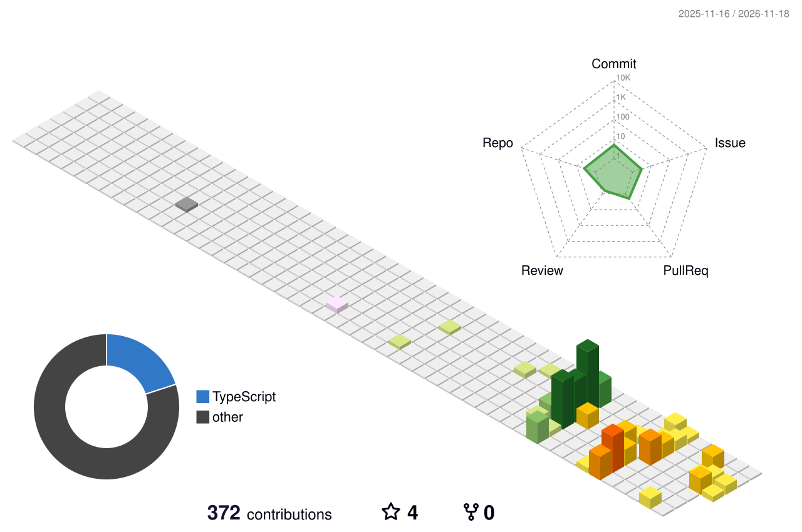

# Hi, I’m Ruiyang

我把重复的工作做成可复用的 AI 工作流和数据工具。

- [Codex Pets](https://github.com/ResonZone/Codex-Pets)，收集和分享 Codex 桌面宠物
- [Jarvis × Codex](https://github.com/ResonZone/jarvis-codex)，macOS 语音助手（Fork）
- [千帆 CLI](https://github.com/ResonZone/xhs-qianfan-cli)，小红书千帆商家后台的只读命令行工具

---

<picture>
  <source media="(prefers-color-scheme: dark) and (prefers-reduced-motion: no-preference)" srcset="https://raw.githubusercontent.com/ResonZone/ResonZone/output/island-dark.svg">
  <source media="(prefers-color-scheme: light) and (prefers-reduced-motion: no-preference)" srcset="https://raw.githubusercontent.com/ResonZone/ResonZone/output/island-light-motion.svg">
  
</picture>

<picture>
  <source media="(prefers-color-scheme: dark)" srcset="https://raw.githubusercontent.com/ResonZone/ResonZone/output/snake-dark.svg">
  
</picture>
